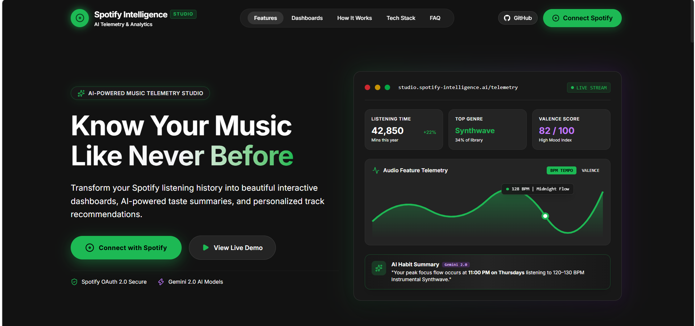

<h1 align="center">Spotify Intelligence Studio</h1>

<h3 align="center">An AI-Powered Music Analytics &amp; Intelligence Platform</h3>

<p align="center">
<strong>Transforming Spotify listening data into meaningful music intelligence.</strong>
</p>

<p align="center">
A full-stack analytics platform that connects with Spotify, retrieves user music data, analyzes listening preferences, explores artist and track insights, and presents music intelligence through interactive dashboards.
</p>

---

## Project Overview

**Spotify Intelligence Studio** is a full-stack music analytics platform designed to provide users with a deeper understanding of their Spotify listening behavior.

The application integrates with the Spotify Web API using OAuth 2.0 authentication to retrieve authorized user information, artists, tracks, and playlists.

Instead of simply displaying music information, the platform organizes Spotify data into interactive dashboards, analytical visualizations, artist rankings, track statistics, playlist insights, and AI-powered recommendations.

The objective is to transform raw music data into an intuitive and visually engaging intelligence platform.

## Dashboard Preview

### Landing Page



> *The landing page as seen when the project is first opened on localhost.*


### Artist Intelligence


### Track Analytics


### Playlist Intelligence


### User Profile


### AI Insights


---

## Key Features

### 1. Spotify Account Integration

- Secure Spotify account authentication using OAuth 2.0 with PKCE.
- Access to authorized Spotify user information.
- Retrieval of Spotify profile details.
- Access-token management and refresh-token handling.
- Backend communication with Spotify Web API.

### 2. Interactive Analytics Dashboard

- Centralized music analytics dashboard.
- Total tracks and artists overview.
- Playlist statistics.
- Listening-related metrics where supported by available data.
- Favorite genre and artist insights where calculated from available data.
- Interactive charts and analytical visualizations.
- Multiple time-range selection options.

### 3. Artist Intelligence

- Explore top Spotify artists.
- Artist ranking and popularity analysis.
- Artist profile information.
- Artist affinity comparisons.
- Identification of frequently appearing artists.
- Visual artist analytics.

### 4. Track Analytics & Features

- Retrieve and display Spotify tracks.
- Track popularity information.
- Track duration analysis.
- Track ranking and sorting.
- Search functionality.
- Album and artist information.
- Track-level analytical comparisons.

### 5. Playlist Intelligence

- Retrieve the user's Spotify playlists.
- Display playlist information.
- Explore playlist collections.
- Analyze available playlist metadata.
- Organize playlist information through an interactive interface.

### 6. AI-Powered Insights

- AI-assisted music intelligence.
- Listening preference analysis.
- Personalized music-related insights.
- AI-generated summaries and recommendations.

*AI-generated results depend on the configured AI integration and the data supplied to it.*

### 7. Intelligence Reports

- Consolidated music analytics.
- Artist and track insights.
- Visual analytical summaries.
- Music preference observations.
- Structured intelligence reporting.

### 8. Intelligence Scores

- Analytical scoring interface.
- Music preference indicators.
- Artist and track comparison metrics.
- Visual representation of calculated insights.

### 9. User Profile

- Spotify profile information.
- Display name and profile image.
- Spotify account country.
- Account type.
- Follower information where available.
- Listening statistics and achievements where supported by the application data.

### 10. Application Settings

- User-facing application settings.
- Dashboard preferences.
- Interface configuration.

---

## Technology Stack

| Category          | Technologies           |
| ----------------- | ---------------------- |
| Frontend          | React.js, TypeScript   |
| Styling           | Tailwind CSS           |
| Icons             | Lucide React           |
| Backend           | Node.js, Express.js    |
| Authentication    | Spotify OAuth 2.0 PKCE |
| External API      | Spotify Web API        |
| Database          | PostgreSQL             |
| ORM               | Prisma                 |
| AI Integration    | Google Gemini API      |
| Development Tools | Vite, npm, Git, GitHub |

---

## System Architecture

The application follows a frontend-backend architecture.

```text
              USER
                |
                v
       REACT FRONTEND
                |
                v
       SPOTIFY LOGIN
                |
                v
       OAUTH 2.0 PKCE
                |
                v
        SPOTIFY AUTH
                |
                v
       AUTHORIZATION
                |
                v
       EXPRESS BACKEND
                |
                v
        SPOTIFY WEB API
                |
                v
       SPOTIFY USER DATA
                |
                v
       DATA PROCESSING
                |
         +------+------+
         |             |
         v             v
      DATABASE       AI SERVICE
     POSTGRESQL       GEMINI
         |             |
         +------+------+
                |
                v
       ANALYTICS ENGINE
                |
                v
       REACT DASHBOARD
                |
                v
       VISUAL INSIGHTS
```

### Application Workflow

1. The user opens Spotify Intelligence Studio.
2. The user connects their Spotify account.
3. Spotify redirects the user through its authorization process.
4. The application obtains the required authorization tokens.
5. The backend communicates with Spotify Web API.
6. Spotify returns the information permitted by the user's authorization scopes.
7. The application processes and organizes the retrieved information.
8. Relevant information is displayed through dashboard components.
9. Analytical and AI-assisted features generate additional insights where configured.

---

## Spotify API Integration

Spotify Web API is the primary external data source for this application.

The backend communicates with Spotify endpoints to retrieve authorized account information.

Examples of API resources used by the application include:

| API Endpoint         | Purpose                       |
| -------------------- | ----------------------------- |
| `/v1/me`             | Retrieve Spotify user profile |
| `/v1/me/top/artists` | Retrieve top artists          |
| `/v1/me/top/tracks`  | Retrieve top tracks           |
| `/v1/me/playlists`   | Retrieve user playlists       |
| `/v1/artists/{id}`   | Retrieve artist information   |
| `/v1/tracks/{id}`    | Retrieve track information    |

The actual availability of each endpoint depends on Spotify API access, granted scopes, and current Spotify platform policies.

### Authentication

The project uses Spotify OAuth 2.0 PKCE authentication.

The authentication workflow involves:

- Authorization request.
- Code verifier generation.
- Code challenge generation.
- User authorization.
- Authorization-code exchange.
- Access-token management.
- Refresh-token handling.

Access tokens are used to authorize API requests.

The backend handles token-related operations and communication with Spotify.

**Security note:** Access tokens, refresh tokens, client secrets, and other credentials must never be committed to GitHub.

---

## Project Structure

The project is organized into separate frontend and backend directories.

```text
Spotify-Intelligence-Studio/
│
├── frontend/
│   ├── src/
│   │   ├── components/
│   │   ├── views/
│   │   ├── pages/
│   │   ├── services/
│   │   └── App.tsx
│   │
│   ├── public/
│   ├── package.json
│   └── vite.config.ts
│
├── backend/
│   ├── routes/
│   ├── controllers/
│   ├── middleware/
│   ├── prisma/
│   ├── services/
│   ├── package.json
│   └── server.js
│
├── assets/
│   ├── dashboard-preview.png
│   ├── artists-dashboard.png
│   ├── tracks-dashboard.png
│   ├── playlists-dashboard.png
│   ├── profile-dashboard.png
│   └── ai-insights.png
│
├── .gitignore
└── README.md
```

*The directory structure above illustrates the intended organization. Adjust filenames and folders to match the actual implementation.*

---

## Installation and Setup

Follow these instructions to run the project locally.

### Prerequisites

Install the following:

- Node.js
- npm
- Git
- PostgreSQL (if using the database features)
- Spotify Developer account

### Step 1: Clone the Repository

```bash
git clone https://github.com/priyalllll/Spotify-Intelligence-Studio.git
```

Navigate into the project:

```bash
cd Spotify-Intelligence-Studio
```

### Step 2: Configure the Backend

```bash
cd backend
npm install
```

Create a `.env` file inside the backend directory.

Example configuration:

```env
PORT=5000

SPOTIFY_CLIENT_ID=your_spotify_client_id
SPOTIFY_CLIENT_SECRET=your_spotify_client_secret

FRONTEND_URL=http://localhost:5173
BACKEND_URL=http://localhost:5000

DATABASE_URL=your_postgresql_connection_string

GEMINI_API_KEY=your_gemini_api_key
```

Only configure variables for integrations actually enabled in your project. Follow the environment-variable names expected by your backend code.

### Step 3: Configure Spotify Developer Application

1. Visit [https://developer.spotify.com/dashboard](https://developer.spotify.com/dashboard)
2. Create or open your Spotify application.
3. Copy your Spotify Client ID.
4. Configure the appropriate redirect URI.
5. Add the credentials to your backend `.env` file.
6. Ensure the redirect URI matches your application's OAuth configuration.

### Step 4: Configure the Database

If PostgreSQL and Prisma are configured:

```bash
npx prisma generate
npx prisma migrate dev
```

Run these commands from the backend directory, using the database configuration expected by your Prisma schema.

### Step 5: Start the Backend

Open a terminal:

```bash
cd backend
npm run dev
```

The backend should run at:

```text
http://localhost:5000
```

### Step 6: Start the Frontend

Open another terminal:

```bash
cd frontend
npm install
npm run dev
```

The Vite development server will display its local URL, typically:

```text
http://localhost:5173
```

Open that URL in your browser.

---

## Security Considerations

Security is an important aspect of Spotify account integration.

The application follows these security considerations:

- OAuth 2.0 PKCE authentication.
- Authorization-based API access.
- Secure handling of authentication tokens.
- Backend-based communication with external APIs.
- Environment variables for sensitive configuration.
- Protection of credentials from public repositories.
- Appropriate error handling for expired or invalid tokens.

Never expose access tokens or refresh tokens in public URLs, screenshots, source code, or GitHub commits.

---

## Important API Limitations

Spotify API access depends on the permissions granted to the application and the current availability of Spotify endpoints.

Some listening-related information, such as complete historical listening hours, real-time playback history, or detailed audio features, may not be directly available through the API.

Therefore:

- Some metrics may be calculated from available data.
- Some visualizations may use derived analytical values.
- Some features may require additional data sources.
- AI-generated insights depend on the available input data.

The application should distinguish actual Spotify API data from calculated or illustrative metrics.

---

## Future Enhancements

Potential future improvements include:

- Advanced listening trend analysis.
- More detailed music preference clustering.
- Enhanced AI-powered recommendations.
- Advanced artist similarity analysis.
- Personalized music discovery.
- Improved playlist intelligence.
- Historical listening analytics through additional data sources.
- Exportable PDF intelligence reports.
- More advanced data visualization.
- Enhanced user experience and performance optimization.

---

## Learning Outcomes

Developing Spotify Intelligence Studio provides practical experience in:

- Full-stack application development.
- React and TypeScript.
- REST API integration.
- OAuth 2.0 and PKCE authentication.
- Backend development using Node.js and Express.
- External API communication.
- Database integration.
- Data processing and visualization.
- AI service integration.
- Application security and token management.

---

## Author

**Priyal Rathore**

B.Tech – Computer Engineering

SVKM's NMIMS, Indore

GitHub: [@priyalllll](https://github.com/priyalllll)

---

## License

This project is developed for educational and portfolio purposes.

Spotify is a trademark of Spotify AB. This project is an independent application and is not affiliated with, endorsed by, or officially connected to Spotify.

---

<p align="center">   <strong>Spotify Intelligence Studio</strong>   \<br/>   Turning Music Data Into Intelligence. </p>
